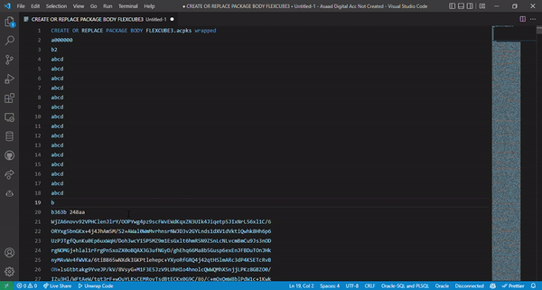

# PL/SQL Unwrapper

A VS Code extension that unwraps Oracle PL/SQL wrapped code locally - no internet connection required!

## Features

- **Local Unwrapping** - All unwrapping happens locally on your machine. Your code never leaves your computer.
- **Fast** - No network latency, instant results.
- **Offline Support** - Works without an internet connection.
- **Code Formatting** - Automatically formats the unwrapped code and removes extra newlines.

### Unwrap Code
Use `Ctrl+Shift+U` or click the **Unwrap Code** button in the status bar to unwrap wrapped PL/SQL code.

### Format Code
Use `Ctrl+Alt+U` to format and remove extra newlines from PL/SQL code.

### Demo

> **Tip:** You can also use the "Unwrap Code" command from the Command Palette (`Ctrl+Shift+P`).

## Usage

1. Open a file containing wrapped Oracle PL/SQL code
2. Press `Ctrl+Shift+U` or click "Unwrap Code" in the status bar
3. The code will be unwrapped and formatted automatically

## Keyboard Shortcuts

| Command | Windows/Linux | Mac |
|---------|---------------|-----|
| Unwrap Code | `Ctrl+Shift+U` | `Ctrl+Shift+U` |
| Format Code | `Ctrl+Alt+U` | `Ctrl+Alt+U` |

## Requirements

None - this extension has no external dependencies.

## Release Notes

### 0.0.7
- Unwrapping now happens locally instead of using external API
- No internet connection required
- Faster unwrapping with no network latency
- Your code stays private - never sent to external servers

### 0.0.6
- Initial release with API-based unwrapping

## Report an Issue

Found a bug? Have a feature request? Please open an issue at:
https://github.com/hammad11ali/OraclePLSQLUnwrapper/issues

---

**Extension icon by [Icons8](https://icons8.com/)**
